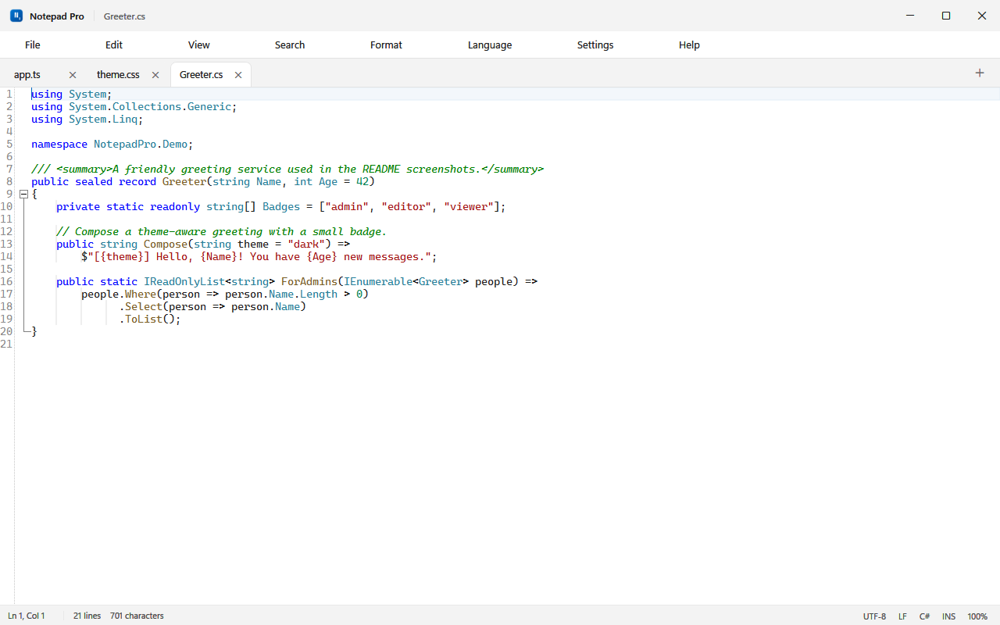
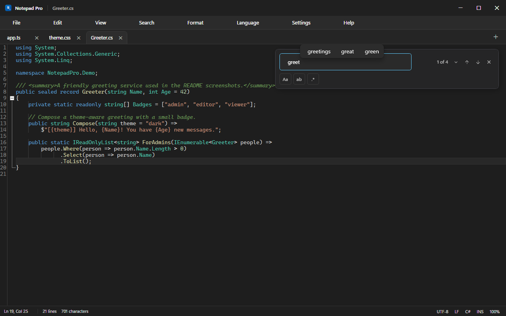
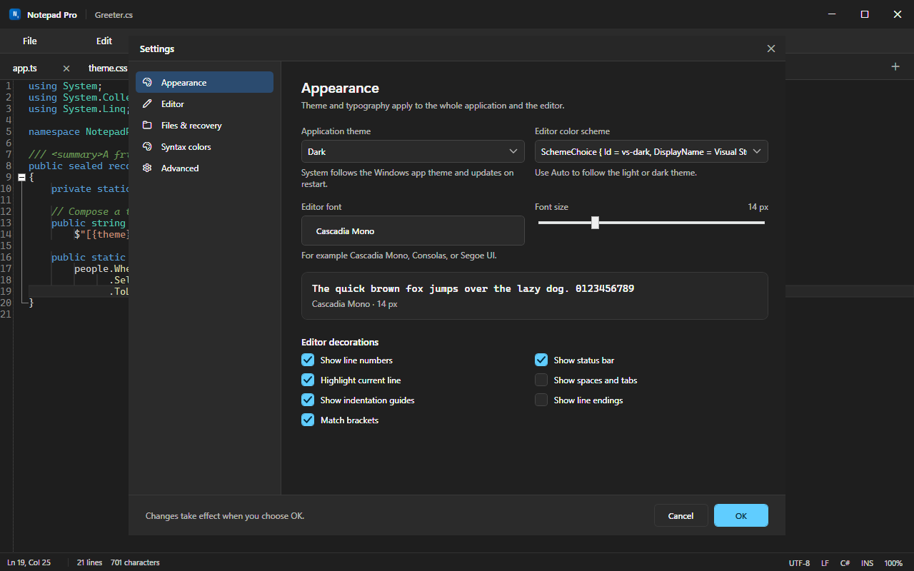

<p align="center">
  
</p>

<h1 align="center">Notepad Pro</h1>

<p align="center">
  <b>The simplicity of Notepad. The features you actually miss.</b><br>
  A fast, native Windows editor with syntax highlighting, tabs, search, themes, and zero telemetry.
</p>

<p align="center">
  <a href="https://github.com/amh2002/notepad-pro/releases/latest"></a>
  <a href="https://github.com/amh2002/notepad-pro/actions/workflows/build.yml"></a>
  <a href="https://github.com/amh2002/notepad-pro/releases"></a>
  <a href="LICENSE"></a>
  
  
</p>

<p align="center">
  <a href="#download"></a>
</p>

<p align="center">
  
</p>

<p align="center">
  <sub>Visual Studio Dark · C# · TypeScript and CSS tabs · line numbers and status bar</sub>
</p>

| ⚡ **Fast** | 🪶 **Light** | 🎨 **Made for code** |
| :---: | :---: | :---: |
| Starts in about a second | ~70 MB, self-contained | 21 languages, 6 color schemes |

Notepad Pro is a real desktop application built with **C# / WPF on .NET 10** and the
[AvalonEdit](https://github.com/icsharpcode/AvalonEdit) text engine. It opens quickly, uses a fraction
of the memory of an Electron editor, and never touches the network. No telemetry, no accounts, no
placeholders — every menu item, shortcut, and setting does something.

> [!NOTE]
> **New in 1.0.2:** syntax highlighting is fixed in C#, HTML, and XML, and several theme rules now
> render correctly, including CSS hex colors, Rust attributes, and Markdown headings.
> See the [changelog](CHANGELOG.md) for details.

## Screenshots

<table>
  <tr>
    <td width="50%" align="center">
      <a href="docs/screenshot-light.png"></a><br>
      <sub><b>Visual Studio Light</b> — the same file in a bright palette</sub>
    </td>
    <td width="50%" align="center">
      <a href="docs/screenshot-search.png"></a><br>
      <sub><b>Find &amp; replace</b> — live counts and highlighted matches</sub>
    </td>
  </tr>
</table>

<p align="center">
  <a href="docs/screenshot-settings.png"></a><br>
  <sub><b>Settings</b> — themes, fonts, syntax colors, editor behavior, and recovery</sub>
</p>

## Features

### ⚡ Native, fast, and focused

- Built with **C# / WPF on .NET 10** and the **AvalonEdit** text engine.
- Starts in about a second and stays responsive with large documents.
- Custom Fluent-style title bar, menu bar, tab strip, editor, and status bar.
- No telemetry, no accounts, no background network calls.

### 🎨 Syntax highlighting for 21 languages

`C#` · `C` · `C++` · `Java` · `JavaScript` · `TypeScript` · `Python` · `HTML` · `CSS` · `SCSS` ·
`JSON` · `XML` · `SQL` · `PHP` · `Go` · `Rust` · `Bash` · `PowerShell` · `YAML` · `Markdown` ·
`Plain Text`

- Six editor color schemes: **Auto**, **Visual Studio Light**, **Visual Studio Dark**, **One Dark**,
  **GitHub Light**, and **GitHub Dark**.
- Per-scheme syntax color overrides with a color picker, hex input, and reset.
- Language detection from the file extension **and** document content.
- Paste-to-detect for new untitled documents, plus a manual language override per tab.
- Code folding for braces, XML/HTML, Markdown, and indentation-based languages.

### 🗂️ Tabs, sessions, and the little things

- Multi-tab editing with modified (`*`) indicators and close buttons.
- Tab context menu: Save, Save as, Close, Close others, Close all, Copy full path, Open containing
  folder, and Reload from disk.
- Session restore after restart, **Reopen closed tab** (`Ctrl+Shift+T`), and drag-and-drop files.
- Per-tab caret position, scroll position, folded regions, language, encoding, and line endings.
- Line numbers, current-line highlight, indentation guides, bracket matching, whitespace and
  line-ending markers, word wrap, and zoom.

### 🔍 Search and editing commands

- Find and replace overlay with match count, next/previous navigation, and highlighted results.
- Case-sensitive, whole-word, and .NET regular-expression modes.
- Replace, Replace all, and clear errors for invalid patterns.
- Go to line (`Ctrl+G`), Find next (`F3`), and Find previous (`Shift+F3`).
- Duplicate/delete/move lines, toggle comment, indent/outdent, trim trailing whitespace, convert case,
  and insert date/time.

### 🛡️ Files, encodings, and recovery

- Opens any text file, with first-class support for code and markup extensions.
- Detects UTF-8, UTF-8 with BOM, UTF-16 LE/BE, UTF-32, and an ANSI fallback; preserves the detected
  encoding when saving.
- Detects and preserves **CRLF**, **LF**, and **CR** line endings.
- Atomic saves (temporary file + replace), read-only handling, and external-change detection.
- Background recovery snapshots plus a themed restore prompt on the next launch.
- A 200 MB per-file limit with a clear message instead of an out-of-memory crash.

### 🌗 Themes and typography

- Application themes: **System** (follows Windows), **Light**, and **Dark**.
- The whole shell — menus, tabs, dialogs, prompts, and the status bar — follows the active theme.
- Configurable editor font, size, tab size, soft tabs, and layout toggles.
- A live preview in Settings shows the selected font and syntax palette.

## Download

<p align="center">
  <a href="https://github.com/amh2002/notepad-pro/releases/latest"></a>
</p>

| Asset | Description |
| --- | --- |
| `NotepadPro.exe` | Portable single file. Double-click and go — no installation required. |
| `NotepadPro-1.0.2-win-x64.zip` | Portable bundle: executable, README, license, and install/uninstall scripts. |
| `SHA256SUMS.txt` | SHA-256 checksums for both downloads. |

**Requirements:** Windows 10 or 11, 64-bit. The executable is self-contained, so the .NET runtime is
not required.

> [!WARNING]
> The build is not code-signed, so Windows SmartScreen may show *"Windows protected your PC"* the
> first time you run it. Choose **More info → Run anyway**, or verify the download with the
> checksums below.

### Install for the current user

The zip includes `install.ps1`, which copies the executable to
`%LOCALAPPDATA%\Programs\NotepadPro`, adds a Start Menu shortcut, and registers Notepad Pro in the
Windows **Open with** menu:

```powershell
powershell -ExecutionPolicy Bypass -File .\install.ps1
```

Add `-DesktopShortcut` for a desktop shortcut. No administrator rights are needed.

To remove it (settings and recovery data are kept):

```powershell
powershell -ExecutionPolicy Bypass -File .\uninstall.ps1
```

### Verify a download

```powershell
Get-FileHash .\NotepadPro.exe -Algorithm SHA256
Get-Content .\SHA256SUMS.txt
```

## Keyboard shortcuts

<details>
<summary><b>Show all shortcuts</b></summary>

| Action | Shortcut |
| --- | --- |
| New tab | `Ctrl+N` |
| Open file | `Ctrl+O` |
| Save | `Ctrl+S` |
| Save as | `Ctrl+Shift+S` |
| Save all | `Ctrl+Alt+S` |
| Close tab | `Ctrl+W` |
| Close window | `Ctrl+Shift+W` |
| Reopen closed tab | `Ctrl+Shift+T` |
| Next / previous tab | `Ctrl+Tab` / `Ctrl+Shift+Tab` |
| Find / replace | `Ctrl+F` / `Ctrl+H` |
| Find next / previous | `F3` / `Shift+F3` |
| Go to line | `Ctrl+G` |
| Undo / redo | `Ctrl+Z` / `Ctrl+Y` |
| Duplicate line | `Ctrl+D` |
| Delete line | `Ctrl+Shift+K` |
| Move line up / down | `Alt+Up` / `Alt+Down` |
| Toggle comment | `Ctrl+/` |
| Indent / outdent | `Tab` / `Shift+Tab` |
| Insert date and time | `F5` |
| Zoom in / out / reset | `Ctrl+Plus` / `Ctrl+Minus` / `Ctrl+0` |
| Word wrap | ``Ctrl+` `` |
| Toggle whitespace | `Ctrl+Shift+8` |
| Toggle status bar | `Ctrl+Shift+B` |
| Settings | `Ctrl+,` |
| Keyboard shortcuts | `F1` |

</details>

## Build from source

### Requirements

- Windows 10 or 11 (x64)
- [.NET SDK 10.0](https://dotnet.microsoft.com/download) or newer
- Visual Studio 2022+ or VS Code are optional

### Commands

```powershell
# Restore and build
dotnet build NotepadPro.sln -c Release

# Run all tests (Core and WPF syntax-highlighting tests)
dotnet test NotepadPro.sln -c Release

# Run from source
dotnet run --project src\NotepadPro\NotepadPro.csproj

# Produce the self-contained single executable
dotnet publish src\NotepadPro\NotepadPro.csproj -c Release -o dist `
  -p:DebugType=None -p:DebugSymbols=false
```

The published executable is `dist\NotepadPro.exe` (about 70 MB, self-contained).

Pushing a tag such as `v1.0.2` runs the [release workflow](.github/workflows/release.yml), which
rebuilds, retests, packages the zip, and publishes a GitHub release with checksums.

## Project layout

```
src/
  NotepadPro.Core/           Platform-neutral models and services
    Models/                  AppSettings, documents, language definitions, search options
    Services/                FileService, SettingsService, RecoveryService, language catalog
    Utils/                   Search engine, text helpers
  NotepadPro/                WPF application
    Editor/                  AvalonEdit host, indentation, folding, renderers, highlighting
    Dialogs/                 Settings, Go to line, About, Shortcuts, color picker, prompts
    Themes/                  Light/Dark palettes and shared control styles
    Theming/                 Theme service, color schemes, syntax-category palettes
    ViewModels/              Main and per-document view models
    MainWindow.xaml(.cs)     Shell, menus, tabs, status bar, and command orchestration
tests/
  NotepadPro.Core.Tests/     xUnit tests for search, encodings, settings, recovery, languages
  NotepadPro.App.Tests/      WPF-layer tests that load and verify every generated syntax definition
.github/workflows/           CI build/test and tag-driven release automation
install.ps1                  Per-user installer
uninstall.ps1                Per-user uninstaller
```

### Design notes

- A single shared AvalonEdit `TextEditor` is re-attached when the active tab changes; each tab owns
  its own `TextDocument`, encoding, line endings, language, and view state.
- Syntax highlighting definitions are generated at runtime as XSHD from language metadata and the
  active color scheme, then cached per language/palette.
- Search uses a custom overlay and background renderer, not AvalonEdit's stock search panel.
- Settings and session files are plain JSON written atomically (temporary file + replace).
- Core logic has no WPF dependency and is covered by 94 unit tests; the WPF syntax layer has 48 more.

## Data locations

| Data | Location |
| --- | --- |
| Settings | `%APPDATA%\NotepadPro\settings.json` |
| Session and recent files | `%APPDATA%\NotepadPro\session.json` |
| Recovery snapshots | `%LOCALAPPDATA%\NotepadPro\Recovery` |
| Error log | `%LOCALAPPDATA%\NotepadPro\error.log` |

Deleting these folders resets Notepad Pro to its defaults.

## Known limitations

<details>
<summary><b>Show limitations</b></summary>

- No multi-cursor or column/box selection.
- No minimap and no native line-spacing control (the AvalonEdit engine does not expose one).
- No split view or preview pane.
- Regular expressions use .NET syntax rather than JavaScript or PCRE syntax.
- The application is x64-only; an ARM64 build would need a separate publish target.
- Default file associations must be confirmed by the user in Windows Settings.
- Files larger than 200 MB are declined rather than opened in a degraded mode.
- Very large documents (tens of MB) may take a moment to highlight and fold.
- Release builds are not code-signed, so SmartScreen may warn on first launch.

</details>

## Contributing

Bug reports and pull requests are welcome. See [CONTRIBUTING.md](CONTRIBUTING.md) for build
instructions, code style, and how to submit changes.

## License

[MIT](LICENSE) © 2026 Abdulrahman Hussein.

Built with .NET and [AvalonEdit](https://github.com/icsharpcode/AvalonEdit) (MIT).
