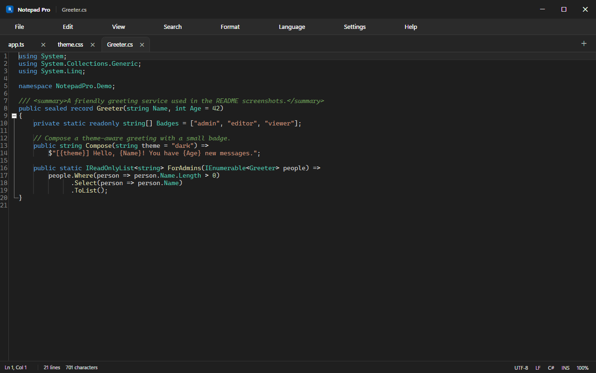

<div align="center">

# Notepad Pro

**A fast, native Windows text and code editor — the simplicity of Notepad, with the features you actually miss.**

[](https://github.com/amh2002/notepad-pro/releases/latest)
[](https://github.com/amh2002/notepad-pro/actions/workflows/build.yml)
[](https://github.com/amh2002/notepad-pro/releases)
[](LICENSE)
[](#requirements)
[](https://dotnet.microsoft.com/)

[Download](#download) · [Features](#features) · [Shortcuts](#keyboard-shortcuts) · [Build](#build-from-source) · [Contributing](CONTRIBUTING.md)



</div>

Notepad Pro is a real desktop application built with **C# / WPF on .NET 10** and the
[AvalonEdit](https://github.com/icsharpcode/AvalonEdit) text engine. It starts in about a second, uses a
fraction of the memory of an Electron editor, and never touches the network. No telemetry, no accounts,
no placeholders — every menu item, shortcut, and setting does something.

## Download

[**Download the latest release →**](https://github.com/amh2002/notepad-pro/releases/latest)

| File | Description |
| --- | --- |
| `NotepadPro.exe` | Portable single file. Double-click and go — no installation required. |
| `NotepadPro-1.0.2-win-x64.zip` | Portable bundle: executable, README, license, and install/uninstall scripts. |
| `SHA256SUMS.txt` | SHA-256 checksums for both downloads. |

**Requirements:** Windows 10 or 11, 64-bit. The executable is self-contained, so the .NET runtime is
not required.

> **Windows SmartScreen:** the build is not code-signed, so Windows may show *"Windows protected your
> PC"* the first time you run it. Choose **More info → Run anyway**. You can verify the download with
> the checksums below.

### Install for the current user

The zip includes `install.ps1`, which copies the executable to
`%LOCALAPPDATA%\Programs\NotepadPro`, adds a Start Menu shortcut, and registers Notepad Pro in the
Windows **Open with** menu:

```powershell
powershell -ExecutionPolicy Bypass -File .\install.ps1
```

Add `-DesktopShortcut` for a desktop shortcut. No administrator rights are needed.

To remove it (settings and recovery data are kept):

```powershell
powershell -ExecutionPolicy Bypass -File .\uninstall.ps1
```

### Verify a download

```powershell
Get-FileHash .\NotepadPro.exe -Algorithm SHA256
Get-Content .\SHA256SUMS.txt
```

## Features

### Window and tabs

- Custom Fluent-style title bar with the document name, a modified (`*`) indicator, and native
  minimize / maximize / close behavior.
- Multi-tab editing with per-tab modified indicators and close buttons.
- Tab context menu: Save, Save as, Close, Close other tabs, Close all tabs, Copy full path, Open
  containing folder, Reload from disk.
- Session restore after restart, plus **Reopen closed tab** (`Ctrl+Shift+T`).
- Drag and drop files onto the window to open them.
- Per-tab caret position, scroll position, folded regions, language, encoding, and line endings.

### Editor

- Line numbers, current-line highlight, indentation guides, bracket matching, and whitespace /
  line-ending markers.
- Code folding for braces, XML/HTML, Markdown, and indentation-based languages.
- Smart auto-indent for C-style braces, Python, and YAML; configurable tab size and soft tabs.
- Word wrap, zoom (`Ctrl+Plus` / `Ctrl+Minus` / `Ctrl+0`), insert/overwrite mode.
- Syntax highlighting for:

  `C#` · `C` · `C++` · `Java` · `JavaScript` · `TypeScript` · `Python` · `HTML` · `CSS` · `SCSS` ·
  `JSON` · `XML` · `SQL` · `PHP` · `Go` · `Rust` · `Bash` · `PowerShell` · `YAML` · `Markdown` ·
  `Plain Text`

- Language detection from the file extension and from document content, automatic detection when
  pasting code into a new untitled document, plus manual language override per tab.

### Search and replace

- Find and replace overlay with match count, next/previous navigation, and highlighted results.
- Case-sensitive, whole-word, and .NET regular-expression modes.
- Replace, Replace all, and clear error reporting for invalid patterns.
- Go to line (`Ctrl+G`), Find next (`F3`), Find previous (`Shift+F3`).

### Editing commands

Undo/redo, cut/copy/paste, select all, duplicate line, delete line, move line up/down, toggle
comment, indent/outdent selection, trim trailing whitespace, convert case (UPPERCASE, lowercase,
Title Case, Sentence case), insert date/time, and full keyboard shortcut coverage.

### Files and encodings

- Opens and saves `.txt`, `.md`, `.cs`, `.js`, `.ts`, `.py`, `.html`, `.css`, `.json`, `.xml`,
  `.sql`, `.yaml`, and any other text file.
- Detects UTF-8, UTF-8 with BOM, UTF-16 LE/BE, UTF-32, and an ANSI fallback; preserves the detected
  encoding when saving, with a manual override.
- Detects and preserves CRLF, LF, and CR line endings.
- Atomic save (temporary file + replace) so a failed write cannot truncate the original.
- Safe handling of read-only files and files changed by another program.
- 200 MB per-file limit with a clear message instead of an out-of-memory crash.

### Appearance

- Application themes: **System** (follows the Windows app theme), **Light**, and **Dark**.
- Editor color schemes: **Auto**, **Visual Studio Light**, **Visual Studio Dark**, **One Dark**,
  **GitHub Light**, and **GitHub Dark**.
- Per-scheme syntax color overrides with a color picker, hex input, palette, and reset.
- Configurable editor font and size, line numbers, current line, guides, brackets, whitespace,
  line endings, status bar, word wrap, folding, tab size, and more.
- The whole shell, including dialogs and message prompts, follows the selected theme.

### Recovery and data safety

- Unsaved documents are snapshotted in the background to
  `%LOCALAPPDATA%\NotepadPro\Recovery`.
- A themed recovery prompt on the next launch lets you restore or discard the snapshots.
- Settings, session, and recent files are written atomically to `%APPDATA%\NotepadPro`.
- Unexpected UI exceptions are logged to `%LOCALAPPDATA%\NotepadPro\error.log` and shown in a
  dialog instead of silently terminating.

## Keyboard shortcuts

| Action | Shortcut |
| --- | --- |
| New tab | `Ctrl+N` |
| Open file | `Ctrl+O` |
| Save | `Ctrl+S` |
| Save as | `Ctrl+Shift+S` |
| Save all | `Ctrl+Alt+S` |
| Close tab | `Ctrl+W` |
| Close window | `Ctrl+Shift+W` |
| Reopen closed tab | `Ctrl+Shift+T` |
| Next / previous tab | `Ctrl+Tab` / `Ctrl+Shift+Tab` |
| Find / replace | `Ctrl+F` / `Ctrl+H` |
| Find next / previous | `F3` / `Shift+F3` |
| Go to line | `Ctrl+G` |
| Undo / redo | `Ctrl+Z` / `Ctrl+Y` |
| Duplicate line | `Ctrl+D` |
| Delete line | `Ctrl+Shift+K` |
| Move line up / down | `Alt+Up` / `Alt+Down` |
| Toggle comment | `Ctrl+/` |
| Indent / outdent | `Tab` / `Shift+Tab` |
| Insert date and time | `F5` |
| Zoom in / out / reset | `Ctrl+Plus` / `Ctrl+Minus` / `Ctrl+0` |
| Word wrap | ``Ctrl+` `` |
| Toggle whitespace | `Ctrl+Shift+8` |
| Toggle status bar | `Ctrl+Shift+B` |
| Settings | `Ctrl+,` |
| Keyboard shortcuts | `F1` |

## Build from source

### Requirements

- Windows 10 or 11 (x64)
- [.NET SDK 10.0](https://dotnet.microsoft.com/download) or newer
- Visual Studio 2022+ or VS Code are optional

### Commands

```powershell
# Restore and build
dotnet build NotepadPro.sln -c Release

# Run all tests (Core and WPF syntax-highlighting tests)
dotnet test NotepadPro.sln -c Release

# Run from source
dotnet run --project src\NotepadPro\NotepadPro.csproj

# Produce the self-contained single executable
dotnet publish src\NotepadPro\NotepadPro.csproj -c Release -o dist `
  -p:DebugType=None -p:DebugSymbols=false
```

The published executable is `dist\NotepadPro.exe` (about 70 MB, self-contained).

Pushing a tag such as `v1.0.2` runs the [release workflow](.github/workflows/release.yml), which
rebuilds, retests, packages the zip, and publishes a GitHub release with checksums.

## Project layout

```
src/
  NotepadPro.Core/           Platform-neutral models and services
    Models/                  AppSettings, documents, language definitions, search options
    Services/                FileService, SettingsService, RecoveryService, language catalog
    Utils/                   Search engine, text helpers
  NotepadPro/                WPF application
    Editor/                  AvalonEdit host, indentation, folding, renderers, highlighting
    Dialogs/                 Settings, Go to line, About, Shortcuts, color picker, prompts
    Themes/                  Light/Dark palettes and shared control styles
    Theming/                 Theme service, color schemes, syntax-category palettes
    ViewModels/              Main and per-document view models
    MainWindow.xaml(.cs)     Shell, menus, tabs, status bar, and command orchestration
tests/
  NotepadPro.Core.Tests/     xUnit tests for search, encodings, settings, recovery, languages
  NotepadPro.App.Tests/      WPF-layer tests that load and verify every generated syntax definition
.github/workflows/           CI build/test and tag-driven release automation
install.ps1                  Per-user installer
uninstall.ps1                Per-user uninstaller
```

### Design notes

- A single shared AvalonEdit `TextEditor` is re-attached when the active tab changes; each tab owns
  its own `TextDocument`, encoding, line endings, language, and view state.
- Syntax highlighting definitions are generated at runtime as XSHD from language metadata and the
  active color scheme, then cached per language/palette.
- Search uses a custom overlay and background renderer, not AvalonEdit's stock search panel.
- Settings and session files are plain JSON written atomically (temporary file + replace).
- Core logic has no WPF dependency and is covered by 94 unit tests; the WPF syntax layer has 48 more.

## Data locations

| Data | Location |
| --- | --- |
| Settings | `%APPDATA%\NotepadPro\settings.json` |
| Session and recent files | `%APPDATA%\NotepadPro\session.json` |
| Recovery snapshots | `%LOCALAPPDATA%\NotepadPro\Recovery` |
| Error log | `%LOCALAPPDATA%\NotepadPro\error.log` |

Deleting these folders resets Notepad Pro to its defaults.

## Known limitations

- No multi-cursor or column/box selection.
- No minimap and no native line-spacing control (the AvalonEdit engine does not expose one).
- No split view or preview pane.
- Regular expressions use .NET syntax rather than JavaScript or PCRE syntax.
- The application is x64-only; an ARM64 build would need a separate publish target.
- Default file associations must be confirmed by the user in Windows Settings.
- Files larger than 200 MB are declined rather than opened in a degraded mode.
- Very large documents (tens of MB) may take a moment to highlight and fold.
- Release builds are not code-signed, so SmartScreen may warn on first launch.

## Contributing

Bug reports and pull requests are welcome. See [CONTRIBUTING.md](CONTRIBUTING.md) for build
instructions, code style, and how to submit changes.

## License

[MIT](LICENSE) © 2026 Abdulrahman Hussein.

Built with .NET and [AvalonEdit](https://github.com/icsharpcode/AvalonEdit) (MIT).
